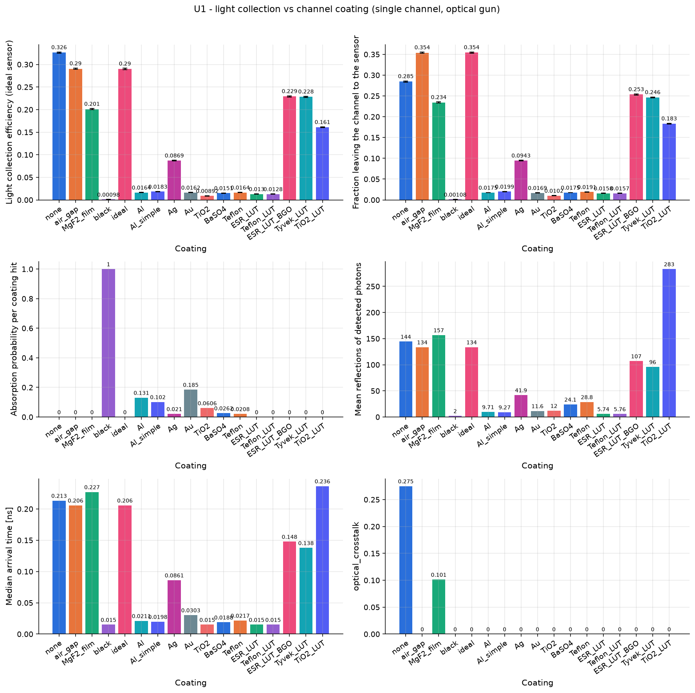
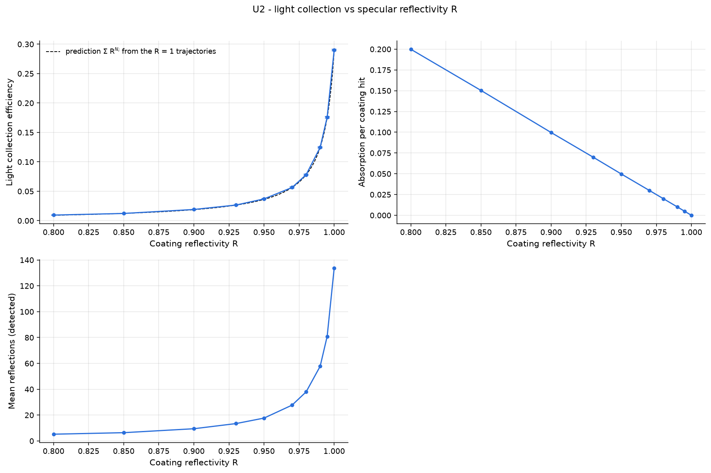
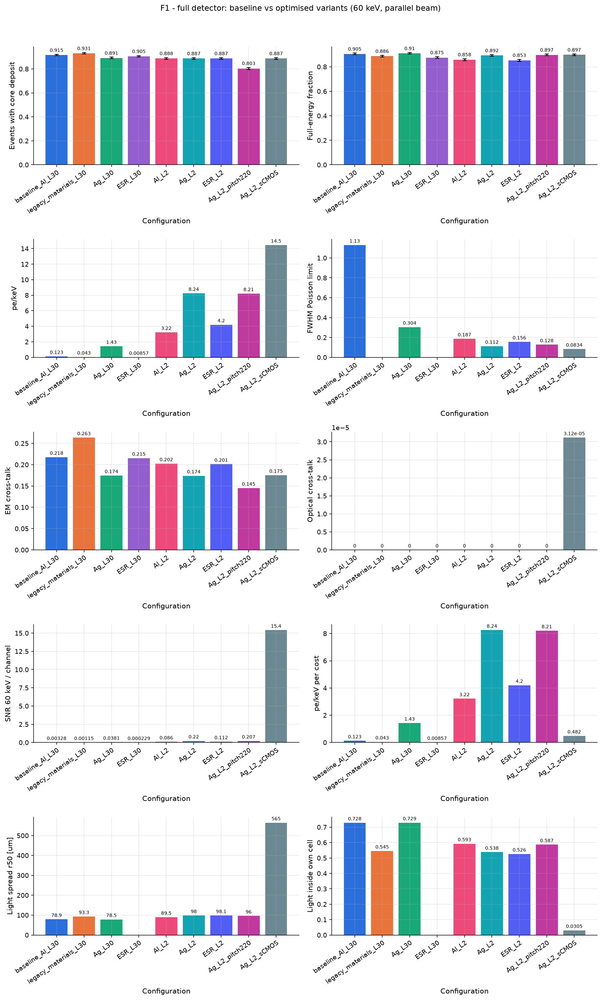

# Эксперименты и выводы

> Таблицы и графики ниже получены командой `srdet study all` в Docker-образе `srdet`
> (Geant4 11.3.2, физ-лист Livermore + оптика). Отчёты каждого исследования с полными таблицами
> лежат в `results/studies/<имя>/report.md`, архивы прогонов — в `results/*.tar.xz`.

## Методика

1. **Единичные кейсы** изолируют по одному параметру при фиксированных остальных:
   * оптика (U01–U06): один канал (`unit`), фотоны рождаются прямо в сцинтилляторе
     (изотропно, равномерно по объёму, спектр CsI(Tl)), сенсор идеальный. В результат
     входит только транспорт света, без статистики EM-ливня;
   * EM и кросс-ток (U07, U08): кластер из 7 сот, равномерный пучок 60 кэВ по центральной соте;
   * сцинтиллятор и фотоприёмник (U06b, U09): один канал, рентген 60 кэВ;
   * энергетическая зависимость (U10): полный детектор, только EM.
2. **Полный детектор** (B01, B02, F01): разные пучки и источники, затем сравнение базового
   варианта с вариантами, собранными из выводов единичных кейсов.
3. Метрики (определения — в `python/srdet/analysis.py`):
   * `lce` — доля оптических фотонов, зарегистрированных сенсором (включая QE);
   * `lce_exit` — доля фотонов, вышедших из канала к сенсору;
   * `det_yield_per_keV` — фотоэлектронов на кэВ поглощённой энергии;
   * `photopeak_fraction`, `k_escape_fraction`, `em_crosstalk` (доля энергии вне первой
     соты), `optical_crosstalk` (доля света, пришедшего не из своего канала);
   * `resolution_fwhm_poisson_limit` — пуассоновский предел разрешения по фотостатистике.
4. Ошибки — стандартные (биномиальные для долей). Выход сцинтилляции в X-ray прогонах
   масштабирован (`yield_scale`), средние пересчитаны на физический выход.

## Главные выводы

1. **Исходная конструкция (L = 30 мм, Al-покрытие, сенсор на дальнем торце) почти не выводит
   свет к сенсору при рентгене**: 0.12 фотоэлектрона на кэВ, около 7 pe на фотон 60 кэВ (F01).
   Рентген 60 кэВ поглощается в первых ~0.3 мм, свет проходит ~30 мм до сенсора и делает
   ~10 отражений с потерей 13 % на каждом.
2. **Длина канала — главный параметр.** При L = 2 мм выход света растёт в 26 раз для Al и в 67 раз
   для Ag (8.2 pe/кэВ) при том же поглощении рентгена до ~100 кэВ. L имеет смысл выбирать по
   энергии: L ≈ 3/μ(E), то есть ~1 мм при 60 кэВ и ~3–5 мм при 100–150 кэВ.
3. **Покрытие:** из реальных зеркальных лучшее серебро (2 % потерь на касание против 13 % у Al и
   18 % у Au). Диффузные белые краски в каналах с L/D ≫ 1 работают плохо. Решения на ПВО (воздушный
   зазор, низкоиндексная оболочка) дают столько же света, сколько идеальное зеркало, потому что
   выход всё равно ограничен ПВО на торце CsI/смазка (конус ~55°). Но свет вне конуса уходит в
   стенки, а это оптический кросс-ток.
4. **Голый канал** (ПВО CsI/стекло) ярче в 80 раз, но 64–67 % света приходит из чужих каналов.
   Пятно размывается с r50 ≈ 75 мкм (Al) до ≈ 190–235 мкм. Для визуализации нужен отражатель
   или поглощающая прослойка.
5. **Шероховатость критична** для металлов: σα = 1° уменьшает светосбор Al в 2.4 раза.
   **Оптическая смазка** обязательна: +60 % к светосбору по сравнению с воздушным зазором у сенсора.
6. **Стенки:** утолщение стенки (между покрытиями) с 2 до 76 мкм снижает ЭМ-кросс-ток с 13.5 % до 5.8 % (вылет
   K-флуоресценции I/Cs), но fill factor падает с 0.85 до 0.46. Разумный компромисс — шаг 210–220 мкм.
   Свинцовое стекло уменьшает ЭМ-кросс-ток на 20–35 % по сравнению с боросиликатом. Для голых
   каналов лучше боросиликат или кварц (больше перепад n, меньше утечка света).
7. **Фотоприёмник:** a-Si плоская панель — лучшее соотношение цена/сигнал (QE 0.78 на 550 нм).
   Окно сенсора толщиной 0.5 мм (sCMOS) размывает пятно до r50 ≈ 560 мкм, то есть нужна
   волоконно-оптическая пластина или тонкое окно. ФЭУ с бищелочным катодом плохо согласован с
   зелёным CsI(Tl): 8 % от идеального сенсора.
8. **Сцинтиллятор:** CsI(Tl) и GAGG самые яркие (0.15 pe/кэВ в базовой геометрии), GAGG в 14 раз
   быстрее. LYSO и BGO при 60 кэВ не теряют энергию на K-escape (K-края Lu и Bi выше 60 кэВ),
   поэтому photopeak у них 0.91–0.93 против 0.46–0.54 у CsI/NaI/GAGG в канале 200 мкм.
9. **Энергии выше ~300 кэВ** сотовая матрица с ячейкой 200 мкм не локализует: срабатывает 2–22
   соты, ЭМ-кросс-ток 34–88 %. Точка равенства фотоэффекта и комптона лежит между 200 и 300 кэВ,
   как и по XCOM.

## Результаты по исследованиям

Полные таблицы, графики и автоматические наблюдения лежат в
[results/studies/](../results/studies/README.md).

### U01 — покрытие канала
Один канал CsI(Tl), D = 200 мкм, L = 30 мм, фотоны изотропно по объёму, идеальный сенсор.

| покрытие | LCE | поглощение на касание | отражений у детектированных |
|---|---|---|---|
| none (ПВО CsI/стекло) | 0.326 (27 % через стенку) | — | 144 |
| air_gap | 0.290 | — | 134 |
| ideal (R = 1) | 0.290 | 0 | 134 |
| MgF2_film | 0.201 | — | 157 |
| Ag | 0.087 | 0.021 | 42 |
| Al / Al_simple | 0.016 / 0.018 | 0.131 / 0.102 | 10 / 9 |
| Au | 0.016 | 0.185 | 12 |
| TiO2 / BaSO4 / Teflon (ламберт) | 0.009 / 0.015 / 0.016 | 0.06 / 0.026 / 0.021 | 12–29 |
| ESR_LUT / Teflon_LUT (LUTDAVIS) | 0.013 | 4.7 % ухода через обёртку | 6 |
| ESR/Tyvek/TiO2 LUT (BGO) | 0.23 / 0.23 / 0.16 | — | 96–283 |

У идеального зеркала и воздушного зазора исходы разные: у зеркала 50 % фотонов поглощается в
объёме, у зазора 38 % уходит наружу. Детектируются же одни и те же фотоны в конусе ~55° к оси.
Таблицы LUT для BGO (n = 2.15) к CsI переносить нельзя, ориентир — LUTDAVIS (LYSO, n = 1.82).

### U02 — коэффициент отражения
LCE(R) совпадает с независимым предсказанием `Σ R^{N_i}` по траекториям прогона с R = 1 во всём
диапазоне. Это проверка учёта отражений. Чувствительность огромная: R = 0.90 → 1.9 %,
R = 0.99 → 12.5 %, R = 0.995 → 17.6 %.

### U03 — глубина эмиссии (неоднородность)
Светосбор от дальнего торца к ближнему: Al 0.004 → 0.12 (в 30 раз), Ag 0.054 → 0.17 (в 3 раза).
У голого канала он плоский (~0.325): ПВО не теряет свет. Для металлов в длинном канале сигнал
сильно зависит от глубины взаимодействия, что портит энергетическое разрешение.

### U04 — длина и диаметр
Светосбор одного канала (оптическая пушка, D = 200 мкм), диапазон расширен до 0.2–100 мм:

| L, мм | 0.2 | 0.5 | 1 | 2 | 3 | 5 | 10 | 20 | 30 | 50 | 100 |
|---|---|---|---|---|---|---|---|---|---|---|---|
| Al | 0.277 | 0.235 | 0.187 | 0.134 | 0.103 | 0.071 | 0.041 | 0.023 | 0.016 | 0.011 | 0.006 |
| Ag | 0.311 | 0.304 | 0.289 | 0.267 | 0.245 | 0.214 | 0.163 | 0.112 | 0.087 | 0.058 | 0.033 |
| ESR_LUT | 0.285 | 0.248 | 0.204 | 0.146 | 0.111 | 0.073 | 0.037 | 0.019 | 0.013 | 0.008 | 0.004 |

При L ≲ 0.5 мм покрытие почти не важно (0.28–0.31: свет выходит после 2–3 отражений), к 100 мм
серебро даёт в 5–8 раз больше света, чем Al и ESR.

**U04c — длина с рентгеном** (Ag, a-Si, узкий пучок по оси канала). Итоговая величина —
фотоэлектронов на кэВ *падающего* пучка = pe/кэВ поглощённого × эффективность:

| L, мм | 0.1 | 0.2 | 0.5 | 1 | 2 | 5 | 10 | 20 | 30 |
|---|---|---|---|---|---|---|---|---|---|
| 30 кэВ | 2.50 | 4.17 | 6.34 | **6.88** | 6.49 | 5.29 | 3.81 | 2.28 | 1.55 |
| 60 кэВ | 2.30 | 4.05 | 6.24 | **6.94** | 6.64 | 5.36 | 3.87 | 2.29 | 1.58 |
| 100 кэВ | 0.69 | 1.26 | 2.84 | 4.32 | **5.55** | 5.31 | 3.87 | 2.29 | 1.55 |
| 150 кэВ | 0.26 | 0.45 | 1.07 | 1.94 | 3.27 | **4.39** | 3.75 | 2.34 | 1.57 |
| 300 кэВ | 0.05 | 0.11 | 0.30 | 0.51 | 0.97 | 1.84 | **2.32** | 2.15 | 1.65 |
| 662 кэВ | 0.03 | 0.05 | 0.17 | 0.25 | 0.41 | 0.96 | 1.29 | **1.43** | 1.32 |

Оптимум сдвигается с энергией: ~1 мм при 30–60 кэВ, 2–5 мм при 100–150 кэВ, ~10 мм при 300 кэВ и
20–30 мм при 662 кэВ. Слева от оптимума теряется рентген, справа — свет. Исходные 30 мм — длина для
жёсткого излучения (Cs-137); для 60 кэВ она даёт в 4.4 раза меньше сигнала, чем 1 мм. Поглощение во
всех точках совпадает с законом Бера–Ламберта по NIST XCOM (страница «Верификация» веб-интерфейса).

Диаметр при L = 30 мм (Al): 25 → 400 мкм даёт LCE 0.0022 → 0.030, примерно ∝ D, потому что
число отражений ∝ L/D.

### U05, U06 — шероховатость, связка
* Al: σα = 0 → 1° → 25° даёт LCE 0.016 → 0.0068 → 0.0028. У зеркала с постоянным R зависимость
  слабая (0.019 → 0.013). Металл хорошо отражает при скользящем падении, а шероховатость эту
  геометрию разрушает.
* Связка у сенсора: воздух 0.0103, смазка 0.0164 (+59 %), эпоксид 0.0173 (+69 %).

### U06b — фотоприёмники (60 кэВ, один канал Al L = 30 мм)
| сенсор | pe/кэВ | относит. идеала | pe/кэВ на единицу цены |
|---|---|---|---|
| ideal | 0.289 | 1.00 | — |
| EMCCD | 0.270 | 0.93 | 0.0045 |
| sCMOS_BSI | 0.265 | 0.92 | 0.0088 |
| aSi_FPD | 0.152 | 0.53 | **0.152** |
| CMOS_FSI | 0.143 | 0.49 | 0.048 |
| SiPM | 0.094 | 0.32 | 0.0019 |
| PMT_bialkali | 0.024 | 0.08 | 0.0003 |

`snr_60keV_per_channel` описывает режим счёта одиночных фотонов. Для интегрирующих панелей
(a-Si) шум чтения делится на много квантов за кадр, поэтому эту метрику нужно читать с поправкой.

### U07, U08 — стенки (кластер из 7 сот, 60 кэВ)
| шаг, мкм | 206 | 210 | 220 | 240 | 280 |
|---|---|---|---|---|---|
| fill factor | 0.85 | 0.82 | 0.75 | 0.63 | 0.46 |
| ЭМ-кросс-ток (Al) | 0.135 | 0.132 | 0.117 | 0.091 | 0.058 |
| свет в своей соте (Al) | 0.81 | 0.85 | 0.85 | 0.89 | 0.94 |
| оптич. кросс-ток (none) | 0.64 | 0.64 | 0.65 | 0.66 | 0.67 |

Пучок направлен в ядро центральной соты, поэтому падение fill factor здесь почти не видно по
эффективности регистрации. В полном детекторе (F01, шаг 220 мкм) эффективность падает с 0.89 до 0.80.
Материал стенки (шаг 220 мкм, Al): ЭМ-кросс-ток у свинцового стекла NIST 0.092, у MCP-стекла
0.117, у боросиликата и кварца 0.140.

### U09 — сцинтиллятор (60 кэВ, a-Si)
| материал | pe/кэВ | photopeak | K-escape | медиана времени, нс |
|---|---|---|---|---|
| CsI_Tl | 0.151 | 0.54 | 0.45 | 822 |
| GAGG | 0.151 | 0.46 | 0.52 | 60 |
| NaI_Tl | 0.099 | 0.52 | 0.47 | 172 |
| LYSO | 0.093 | 0.91 | 0.002 | 31 |
| EJ200 | 0.053 | 0.03 | 0 | 1.7 |
| BGO | 0.024 | 0.93 | 0.005 | 220 |
| CsI_pure | 0.002 | 0.55 | 0.43 | 12 |

### U10 — энергия (полный детектор, только EM)
* Доли первого взаимодействия: фото 0.96 (10 кэВ) → 0.66 (200 кэВ) → 0.42 (300 кэВ) → 0.035
  (1 МэВ). Комптон растёт до 0.54 при 662 кэВ, рождение пар 0.15 при 5 МэВ.
* K-край иода: при переходе 33 → 34 кэВ число флуоресцентных квантов на событие растёт с 0.08
  до 0.75, K-escape с 0 до 0.14 (0.21 при 36 кэВ), ЭМ-кросс-ток с 0.03 до 0.17.
* Photopeak 0.99 (< 33 кэВ) → 0.79 (36 кэВ) → 0.97 (150 кэВ) → 0.30 (662 кэВ) → 0.02 (5 МэВ).
  Срабатывающих сот 1.0 → 2.8 (662 кэВ) → 21.6 (5 МэВ).

### B01, B02 — пучки и источники (полный детектор)
* Пучки 60 кэВ: pencil, параллельный, гауссов и расходящийся дают регистрацию 0.92–0.99 и
  photopeak 0.88–0.91. Изотропный источник в 100 мм попадает в детектор с вероятностью 0.4 %
  (геометрически r²/4d² ≈ 0.3 %).
* Источники: Am-241 — среднее отложение в ядрах 45 кэВ, регистрация 0.91. Co-57 — 94 кэВ, 0.96.
  Cs-137 — 210 кэВ, 0.64, 2.6 соты на событие. Трубка W 80/120 кэВп — 35/42 кэВ.

### F01 — полный детектор (60 кэВ, параллельный пучок r = 10 мм)
| вариант | регистрация | pe/кэВ | FWHM (пуассон) | ЭМ-кросс-ток | r50, мкм | свет в соте |
|---|---|---|---|---|---|---|
| baseline_Al_L30 | 0.92 | 0.12 | 113 % | 0.22 | 79 | 0.73 |
| legacy_materials_L30 | 0.93 | 0.043 | — | 0.26 | 93 | 0.55 |
| Ag_L30 | 0.89 | 1.43 | 30 % | 0.17 | 78 | 0.73 |
| ESR_L30 | 0.91 | 0.009 | — | 0.22 | — | — |
| Al_L2 | 0.89 | 3.22 | 19 % | 0.20 | 90 | 0.59 |
| **Ag_L2** | 0.89 | **8.24** | **11 %** | 0.17 | 98 | 0.54 |
| ESR_L2 | 0.89 | 4.20 | 16 % | 0.20 | 98 | 0.53 |
| Ag_L2_pitch220 | 0.80 | 8.21 | 13 % | 0.15 | 96 | 0.59 |
| Ag_L2_sCMOS | 0.89 | 14.5 | 8 % | 0.18 | 565 | 0.03 |

## Оптимизация (несколько параметров одновременно)

Алгоритм и формат спецификаций описаны в [optimization.md](optimization.md). Отчёты с графиками
лежат в `runs/optimize/<папка>/report.md`, архивы — в `results/*O0*.tar.xz`. Все значения ниже
получены на проверочной стадии (3 повтора с новыми seed, среднее ± σ).

### O01 — геометрия и покрытие (60 кэВ, полный детектор)
Результат ниже получен с L ∈ [0.5, 5] мм; в спецификации диапазон теперь 0.2–30 мм. Свободные параметры: L ∈ [0.5, 5] мм, D ∈ [100, 400] мкм, стенка ∈ [2, 40] мкм, покрытие
{Al, Ag, ESR_LUT}. Цель: pe/кэВ × эффективность. Ограничения: r50 ≤ 120 мкм, ЭМ-кросс-ток ≤ 25 %,
эффективность ≥ 0.8. Всего 64 испытания, из них 39 допустимых.

| L, мм | D, мкм | стенка, мкм | покрытие | цель | pe/кэВ | эффективность | r50, мкм | ЭМ-кросс-ток |
|---|---|---|---|---|---|---|---|---|
| **1.06** | **248** | **3.4** | **Ag** | **8.09 ± 0.02** | 9.31 | 0.869 | 113.9 | 0.143 |
| 1.26 | 248 | 2.0 | Ag | 8.05 ± 0.01 | 9.13 | 0.882 | 114.2 | 0.149 |

* Серебро выигрывает у всех вариантов Al и ESR, как и в U01/U04.
* Длина ~1 мм: при 60 кэВ это ~3.6 длины ослабления, рентген поглощается почти полностью, а
  свет теряется меньше всего.
* Диаметр упирается в ограничение по пятну: r50 ≈ 114 мкм близко к порогу 120 мкм. Более
  крупный канал дал бы больше света ценой разрешения, это и видно на фронте Парето.
* Стенку оптимизатор делает минимальной: так выше fill factor и эффективность.

### O02 — материалы (полный перебор 32 комбинаций, L = 2 мм)
Цель: pe/кэВ × доля фотопика (спектрометрическое качество).

| сцинтиллятор | покрытие | стекло | цель | pe/кэВ | фотопик | K-escape | время, нс |
|---|---|---|---|---|---|---|---|
| **CsI_Tl** | **Ag** | **LeadGlass_MCP** | **7.33 ± 0.07** | 8.25 | 0.889 | 0.091 | 837 |
| CsI_Tl | Ag | Borosilicate | 6.47 ± 0.05 | 8.22 | 0.787 | 0.109 | 836 |
| GAGG | Ag | LeadGlass_MCP | 5.80 ± 0.05 | 6.86 | 0.845 | 0.135 | 62 |

* Свинцовое стекло поднимает фотопик с 0.79 до 0.89 при том же световыходе: оно поглощает
  уходящую K-флуоресценцию рядом с каналом.
* Если важна скорость, лучший компромисс — GAGG: в 13 раз быстрее при 83 % света CsI(Tl).
  Это видно на фронте Парето «свет / время».

### O03 — фотоприёмник и его окно (Ag, L = 2 мм)
Цель: pe/кэВ на единицу относительной цены сенсора при r50 ≤ 150 мкм.

| сенсор | окно, мм | pe/кэВ на цену | pe/кэВ | r50, мкм |
|---|---|---|---|---|
| **aSi_FPD** | **0** | **8.24 ± 0.03** | 8.24 | 98.6 |

* Окно толще ~0.04 мм выводит любой сенсор за ограничение по пятну: свет расходится в стекле.
  Сенсор должен стоять вплотную, либо через волоконно-оптическую пластину.
* Первый запуск O03 выбрал sCMOS: при случайном отборе всем кандидатам a-Si выпали толстые окна.
  После этого алгоритм доработан: LHS стратифицируется внутри каждой категории, а уточнение
  перебирает и категориальные параметры. Это закреплено регрессионным тестом.

### Итоговая рекомендация по оптимизации
L ≈ 1 мм (для 60 кэВ), D ≈ 250 мкм, стенка 2–4 мкм, Ag-покрытие, MCP-стекло со свинцом,
CsI(Tl) (или GAGG, если нужна скорость), оптическая смазка, a-Si панель без окна. Это даёт
~9 pe/кэВ при эффективности ~0.87 и пятне r50 ≈ 114 мкм, примерно в 75 раз больше света,
чем в исходной конструкции.

## Рекомендации и что дальше

* Базовый кандидат: **L = 1–2 мм (под энергию), Ag (с защитным слоем), шаг 208–220 мкм, MCP-
  стекло, CsI(Tl) или GAGG (если нужна скорость), оптическая смазка, a-Si панель без окна или с
  волоконно-оптической пластиной.**
* Проверить канал с низкоиндексной оболочкой плюс поглощающей прослойкой (ПВО без кросс-тока):
  в модели нужна комбинация `air_gap` с поглощающим внешним слоем.
* Для количественных выводов заменить приближённые n+k металлов и QE сенсоров измеренными
  таблицами (`/srdet/mat/loadProperty`) и перезапустить U01, U06b и F01.
* Добавить MTF/LSF по краевому пучку (макрос `macros/beams/pencil_scan.mac`) и шум
  интегрирующего сенсора.
