# Инструкция пользователя: что нажимать, чтобы всё работало

Эта инструкция для тех, кто хочет просто пользоваться: запускать моделирование, смотреть результаты
и скачивать данные, не разбираясь в коде. Цифры в красных кружках на картинках — это шаги.

> **Подсказка прямо в программе:** в левом меню есть кнопка **«❓ Как пользоваться»**. Она по шагам
> подсветит, куда нажимать на той странице, где вы сейчас находитесь.

---

## 0. Один раз: установка

Нужен только **Docker Desktop** (https://www.docker.com/products/docker-desktop). Установите и запустите
его (иконка кита в трее должна быть «зелёной»).

Откройте **Терминал** в папке проекта `SRDetector` и выполните одну команду:

```bash
docker compose build srdet
```

Первый раз это занимает 20–60 минут: внутри собирается Geant4 и скачиваются физические данные.
Это нужно сделать **один раз**, дальше всё запускается за секунды.

## 1. Каждый раз: запустить программу

```bash
docker compose up web
```

Когда в терминале появится `Uvicorn running on http://0.0.0.0:8080`, откройте в браузере
**http://localhost:8080**. Чтобы выключить, нажмите в терминале `Ctrl+C`.

Хотите ту же программу в другом оформлении? Запустите `docker compose up web-pink` (розовая,
http://localhost:8081) или `docker compose up web-rap` (рэп-тема, http://localhost:8082). Всё работает
так же, меняется только внешний вид и подписи.

---

## 2. Главная страница (дашборд)

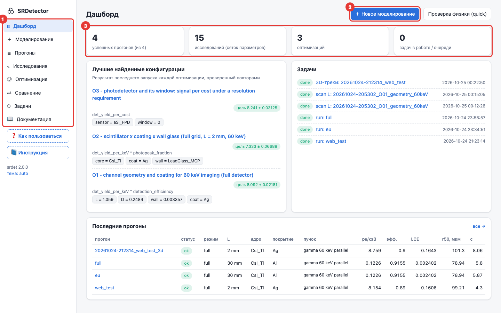

1. **Меню.** Отсюда вы попадаете в любой раздел.
2. **«Новое моделирование»** — главная кнопка, с неё всё начинается.
3. **Счётчики**: сколько прогонов готово, сколько исследований и оптимизаций, что считается сейчас.

Ниже — лучшие найденные конфигурации и последние прогоны. По любому имени можно кликнуть.

---

## 3. Запустить моделирование

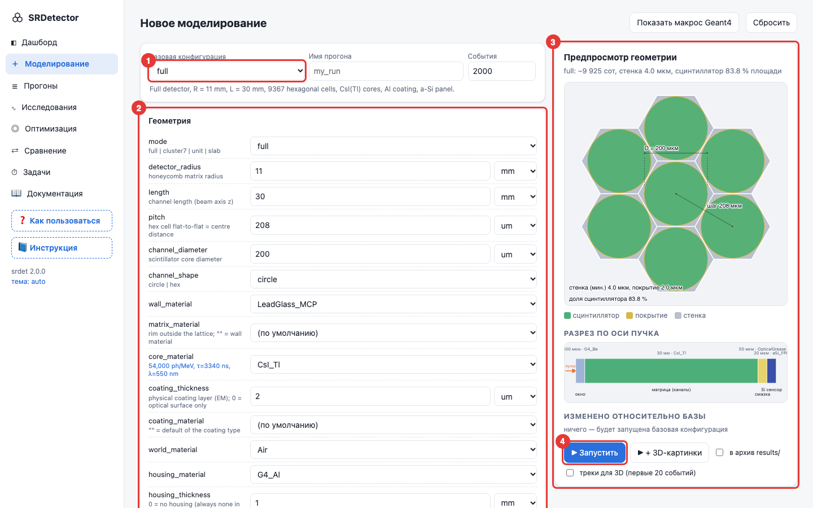

1. **Базовая конфигурация** — выберите заготовку:
   * `full` — весь детектор (≈10 000 сот), рентген 60 кэВ;
   * `unit_optical` — одна сота, считается только свет (быстро, для подбора покрытий);
   * `unit_xray` — одна сота с рентгеном;
   * `cluster7_xray` — 7 сот, чтобы смотреть, сколько энергии и света «утекает» к соседям;
   * `slab_csi` — просто кусок CsI (для проверок физики).
2. **Параметры.** Меняйте что нужно: длину канала, шаг, диаметр, покрытие, материалы, пучок.
   Под каждым полем написано, что оно значит. Изменённые поля подсвечиваются оранжевым, а ненужные
   (например, «радиус пучка» для точечного пучка) скрыты.
3. **Предпросмотр.** Здесь сразу видна сота с размерами и разрез детектора вдоль пучка. Если
   геометрия невозможна (стенка тоньше 1 мкм), появится красное предупреждение и запуск заблокируется.
4. **«Запустить».** Задача встанет в очередь, и откроется страница с живым логом.
   * «+ 3D-картинки» дополнительно сделает картинки сцены от Geant4.
   * Галочка «треки для 3D» сохранит траектории частиц, их можно будет крутить в браузере.
   * Галочка «в архив» упакует удачный результат в папку `results/` для GitHub.

**Сколько ждать?** Одна сота считается секунды. Весь детектор с 2000 событий — от секунд до минуты,
в зависимости от длины канала (свет в длинных каналах отражается много раз).

---

## 4. Посмотреть результат прогона

Откройте **Прогоны** в меню и кликните по имени. Или нажмите «Открыть результат» в логе задачи.

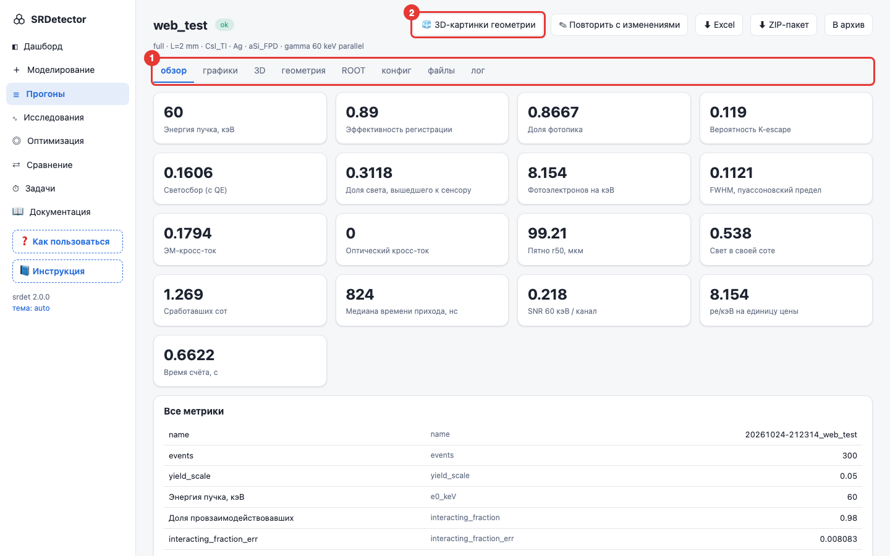

1. **Вкладки:**
   * **обзор** — главные числа с русскими подписями (эффективность, фотоэлектроны на кэВ, пятно, кросс-ток…);
   * **графики** — все гистограммы с подписями осей и единицами (клик по картинке увеличивает);
   * **3D** — частицы, летящие в детекторе (см. ниже);
   * **геометрия** — решётка сот, сота крупным планом, разрез;
   * **ROOT** — интерактивный браузер ROOT-файла;
   * **конфиг**, **файлы**, **лог**.
2. **Кнопки:**
   * **⬇ Excel** — красиво оформленная таблица: сводка, параметры, все события, гистограммы и графики внутри;
   * **⬇ ZIP-пакет** — всё сразу: Excel, CSV, Parquet, картинки, конфиги, ROOT-файл и README с описанием каждого столбца;
   * **«Повторить с изменениями»** — переносит этот прогон в форму, чтобы поменять пару параметров и запустить снова.

### Графики
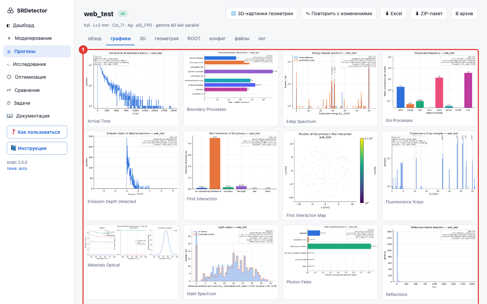

### 3D: как частицы летят через детектор
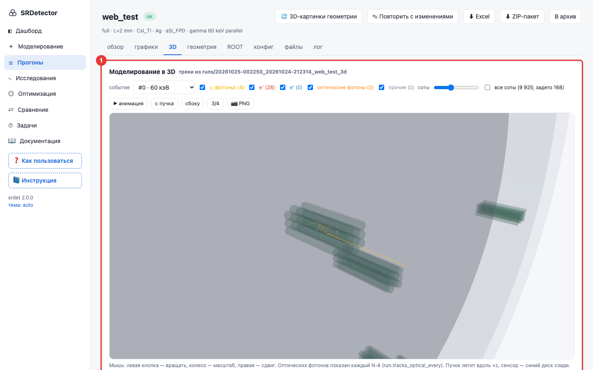

Если треков ещё нет, нажмите **«Смоделировать для 3D»**: будет посчитано 20 событий с той же
конфигурацией. Дальше:
* **мышь:** левая кнопка — вращать, колесо — приблизить, правая — сдвинуть;
* **событие** — показать одно событие (камера сама наведётся) или все;
* **галочки частиц**: жёлтые — рентгеновские/гамма-кванты, красные — электроны, оранжевые — свет
  сцинтиллятора (показан каждый 50-й фотон, иначе их тысячи);
* **«▶ анимация»** — частицы «пролетают» заново; **«📷 PNG»** — сохранить картинку.

### Геометрия
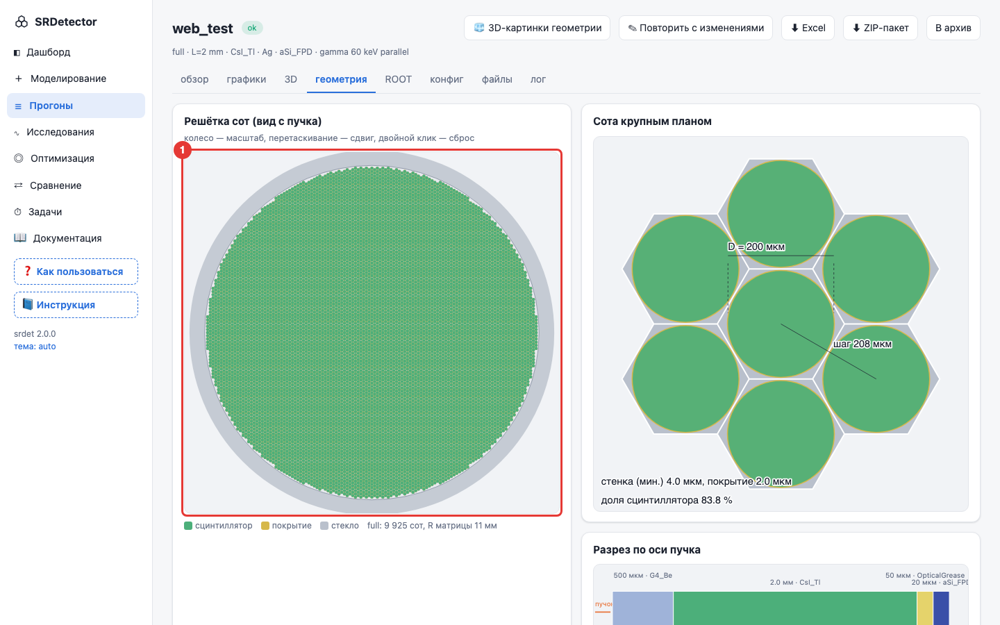

Решётку можно приближать колесом мыши и двигать. Двойной клик возвращает вид целиком.

### ROOT-браузер
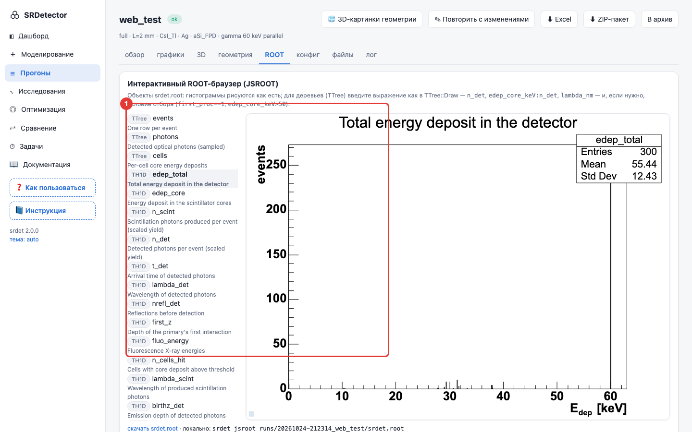

Слева — содержимое файла. Гистограмму нарисует простой клик. Для таблицы `events` впишите выражение,
например `n_det` или `edep_core_keV:n_det` (двумерный график). Во второе поле можно вписать условие
отбора, например `first_proc==1` (только фотоэффект).

---

## 5. Исследования: «что будет, если менять один параметр»

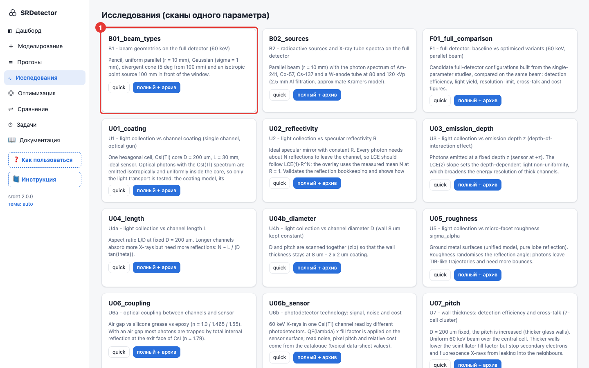

Каждая карточка — готовый эксперимент (U01 — покрытия, U04 — длина канала, U10 — энергия и т. д.).
* **quick** — быстрая прикидка (мало статистики, около минуты);
* **полный + архив** — настоящий расчёт, результат сохранится в `results/`.

Когда расчёт закончится, в «Готовых отчётах» появится отчёт: таблица, графики, автоматические
выводы и интерактивный график, где можно выбрать, что откладывать по осям.

---

## 6. Оптимизация: «найди лучшие параметры сам»

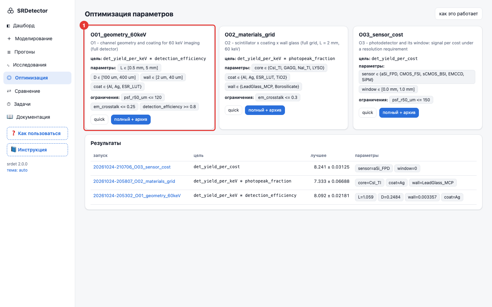

На карточке написано, **что меняется** (параметры и диапазоны), **что максимизируем** (цель) и **какие
ограничения**. Нажмите **quick**, чтобы проверить, что всё работает, затем **полный + архив**.

### Как понять результат: вкладка «параметр → гистограммы»
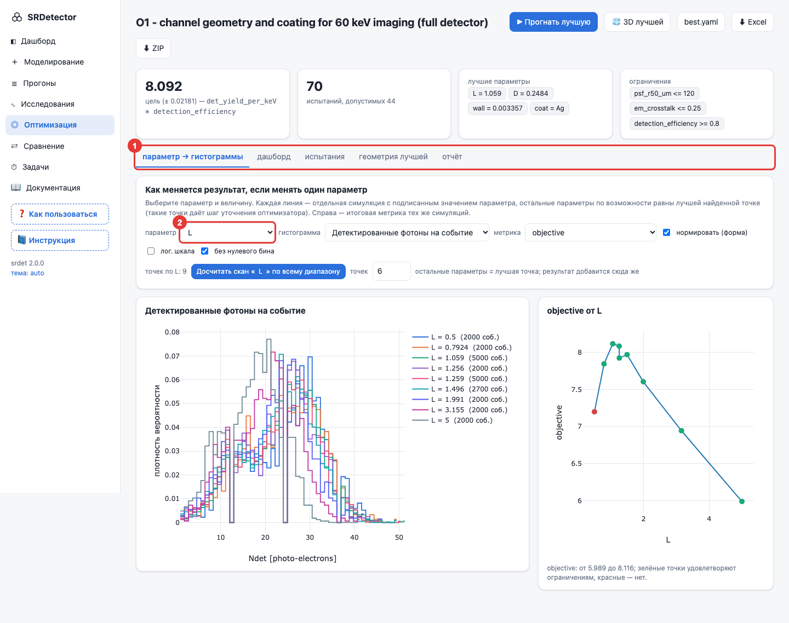

1. Вкладки результата. Начинайте с первой, она самая наглядная.
2. Выберите **параметр** (например, `L` — длину канала) и **гистограмму** (например, «Детектированные
   фотоны»). Каждая цветная линия — симуляция с подписанным значением параметра. Справа видно, как
   при этом меняется итоговая метрика. Зелёные точки удовлетворяют ограничениям, красные — нет.

Если точек мало, нажмите **«Досчитать скан … по всему диапазону»**. Программа посчитает 6 значений
параметра от минимума до максимума, а остальные параметры оставит как в лучшей точке.

### Дашборд оптимизации
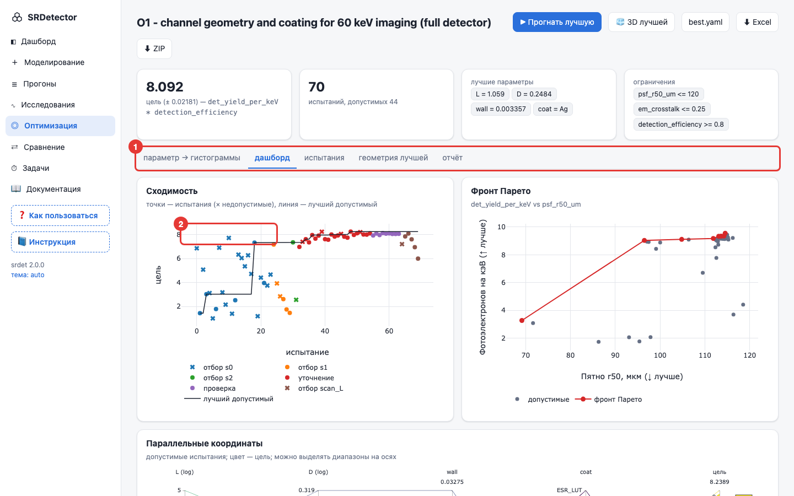

* **Сходимость** показывает, как программа шаг за шагом находила всё лучшие варианты.
* **Фронт Парето** — компромиссы: например, больше света, но хуже разрешение.
* **Параллельные координаты**: каждая линия — испытание, цвет — качество. На осях можно мышью выделять
  диапазоны, остальные линии погаснут.
* Кнопки **«Прогнать лучшую»** и **«3D лучшей»** запускают найденную конфигурацию; **best.yaml** можно
  скачать и отправить коллеге.

---

## 7. Сравнить прогоны

На странице **Прогоны** поставьте галочки у нужных строк и нажмите **«Сравнить выбранные»**.
Откроется таблица метрик рядом и столбчатая диаграмма.

## 8. Задачи

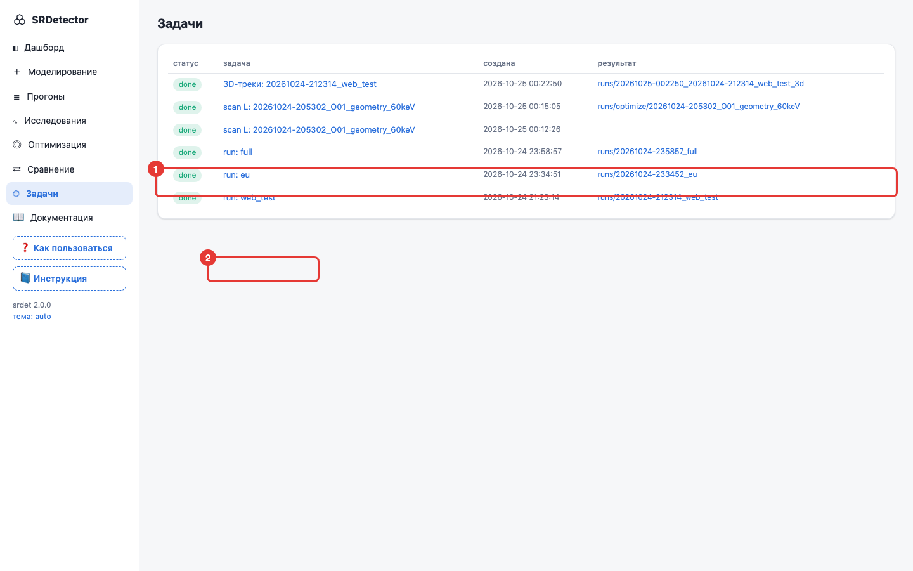

Здесь все запуски и их статус: `queued` — ждёт, `running` — считается, `done` — готово, `failed` —
ошибка. «стоп» прерывает задачу. Клик открывает живой лог.

---

## 9. Рецепты: «я хочу…»

| Хочу | Что нажать |
|---|---|
| посмотреть, как выглядит детектор | Моделирование → выбрать конфигурацию → справа предпросмотр; после прогона — вкладки «геометрия» и «3D» |
| узнать, какое покрытие лучше | Исследования → U01_coating → полный; или Оптимизация → O02 |
| подобрать длину и диаметр канала | Оптимизация → O01 → полный → вкладка «параметр → гистограммы» |
| поменять энергию пучка | Моделирование → раздел «Пучок» → `energy` (например, `100 keV`) |
| поставить радиоактивный источник | раздел «Пучок» → `spectrum` → «радиоактивный источник» → Am241 / Cs137… |
| спектр рентгеновской трубки | `spectrum` → «рентгеновская трубка» → кВп и фильтр |
| получить данные в Excel | страница прогона / исследования / оптимизации → **⬇ Excel** |
| отдать всё коллеге | **⬇ ZIP-пакет**: внутри README с описанием всех столбцов |
| проверить, что физика не сломана | Дашборд → «Проверка физики (quick)» → в задаче должно быть `passed` |
| положить результат на GitHub | при запуске галочка «в архив results/» (или кнопка «В архив» на странице прогона) |

## 10. Словарь

| Слово | Что значит |
|---|---|
| **прогон** | один запуск моделирования с одной конфигурацией |
| **событие** | одна частица пучка и всё, что она натворила в детекторе |
| **сота / канал** | шестиугольная ячейка из стекла и канал со сцинтиллятором внутри |
| **сцинтиллятор** | материал (CsI(Tl) и др.), который светится, когда в нём поглощается рентген |
| **покрытие** | отражающий слой на стенке канала (Al, Ag, ESR…), держит свет внутри |
| **LCE / светосбор** | какая доля света дошла до фотоприёмника |
| **pe/кэВ** | сколько фотоэлектронов даёт 1 кэВ поглощённой энергии; чем больше, тем ярче сигнал |
| **эффективность регистрации** | доля частиц пучка, оставивших энергию в сцинтилляторе |
| **фотопик** | событие, в котором частица отдала всю энергию; доля фотопика нужна для спектрометрии |
| **K-escape** | когда атом йода или цезия испускает свой рентгеновский квант и тот вылетает из канала |
| **кросс-ток** | сколько энергии (ЭМ) или света (оптический) попало не в ту соту |
| **r50 (пятно)** | радиус, в котором собрана половина света: чем меньше, тем резче изображение |
| **оптимизация** | программа сама перебирает параметры и ищет лучшие по заданной цели |
| **ограничение** | условие, которое лучший вариант обязан выполнять (например, r50 ≤ 120 мкм) |

## 11. Если что-то не так

| Симптом | Что делать |
|---|---|
| страница http://localhost:8080 не открывается | проверьте, что Docker запущен и в терминале работает `docker compose up web` |
| задача `failed` | откройте задачу и прочтите конец лога; чаще всего причина — недопустимая геометрия (шаг меньше диаметра + 2 покрытия) |
| 3D или ROOT не рисуются | им нужен интернет (библиотеки грузятся из CDN); обновите страницу |
| порт 8080 занят | `SRDET_WEB_PORT=9000 docker compose up web` и откройте http://localhost:9000 |
| всё очень медленно | уменьшите число событий или выберите `unit_*`; длинные каналы с идеальным зеркалом считаются дольше всего |
| хочу свои картинки в розовой/рэп-теме | положите PNG/JPG в `python/srdet/web/static/themes/pink/user/` (или `rap/user/`) и обновите страницу |

Дальше, если интересно: [запуск из терминала](running.md), [физика модели](physics.md),
[как устроена оптимизация](optimization.md), [результаты экспериментов](experiments.md).
