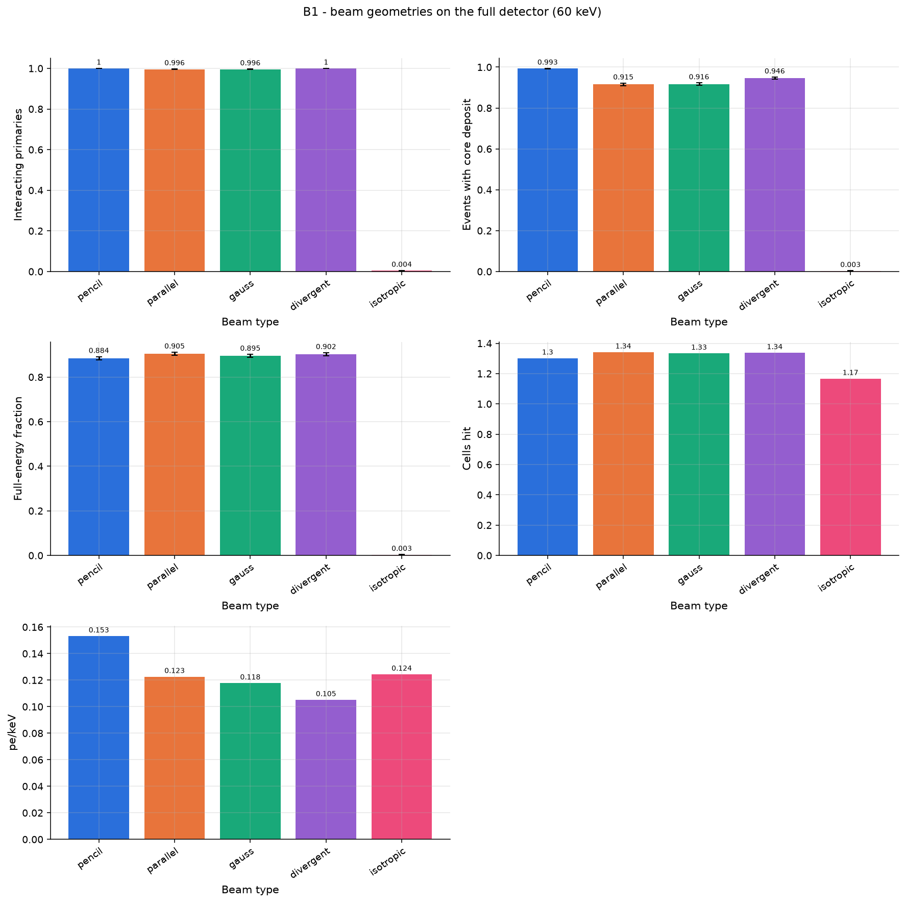

# B1 - beam geometries on the full detector (60 keV)

Pencil, uniform parallel (r = 10 mm), Gaussian (sigma = 1 mm), divergent cone (5 deg from 100 mm) and an isotropic point source 100 mm in front of the window.

Base configuration: `full.yaml`; fixed overrides: `{}`

## Results

| beam.type   |   interacting_fraction |   detection_efficiency |   photopeak_fraction |   mean_cells_hit |   det_yield_per_keV |
|:------------|-----------------------:|-----------------------:|---------------------:|-----------------:|--------------------:|
| pencil      |                 1      |                 0.9925 |               0.8845 |            1.302 |              0.1532 |
| parallel    |                 0.996  |                 0.9155 |               0.905  |            1.342 |              0.1226 |
| gauss       |                 0.9955 |                 0.9165 |               0.895  |            1.334 |              0.1178 |
| divergent   |                 1      |                 0.946  |               0.9025 |            1.337 |              0.1052 |
| isotropic   |                 0.004  |                 0.003  |               0.003  |            1.167 |              0.1244 |

## Automatic observations

- **Interacting primaries**: max 1 at beam.type = pencil, min 0.004 at beam.type = isotropic (ratio 250)
- **Events with core deposit**: max 0.9925 at beam.type = pencil, min 0.003 at beam.type = isotropic (ratio 331)
- **Full-energy fraction**: max 0.905 at beam.type = parallel, min 0.003 at beam.type = isotropic (ratio 302)
- **Cells hit**: max 1.342 at beam.type = parallel, min 1.167 at beam.type = isotropic (ratio 1.15)
- **pe/keV**: max 0.1532 at beam.type = pencil, min 0.1052 at beam.type = divergent (ratio 1.46)
