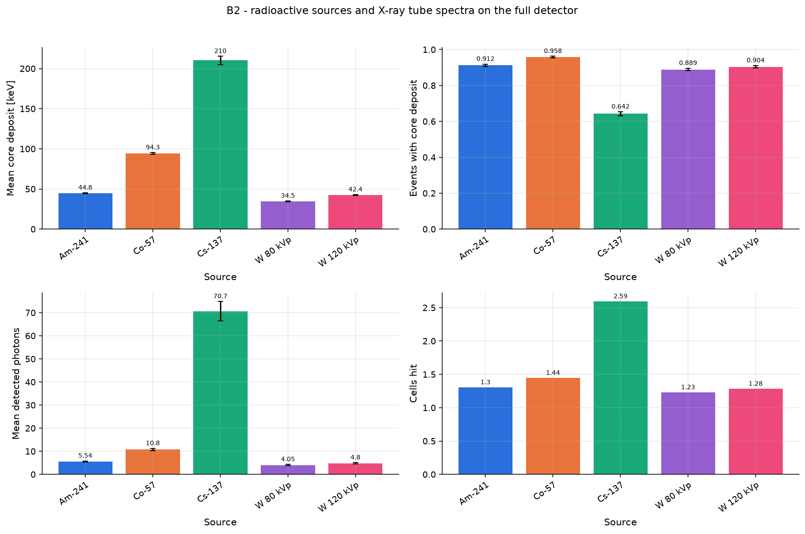

# B2 - radioactive sources and X-ray tube spectra on the full detector

Parallel beam (r = 10 mm) with the photon spectrum of Am-241, Co-57, Cs-137 and a W-anode tube at 80 and 120 kVp (2.5 mm Al filtration, approximate Kramers model).

Base configuration: `full.yaml`; fixed overrides: `{}`

## Results

| beam.spectrum   |   mean_edep_core_keV |   detection_efficiency |   mean_n_det |   mean_cells_hit |
|:----------------|---------------------:|-----------------------:|-------------:|-----------------:|
| Am-241          |                44.77 |                 0.9125 |         5.54 |            1.303 |
| Co-57           |                94.31 |                 0.958  |        10.77 |            1.444 |
| Cs-137          |               210.2  |                 0.6425 |        70.65 |            2.591 |
| W 80 kVp        |                34.55 |                 0.889  |         4.05 |            1.228 |
| W 120 kVp       |                42.38 |                 0.904  |         4.8  |            1.281 |

## Automatic observations

- **Mean core deposit [keV]**: max 210.2 at beam.spectrum = Cs-137, min 34.55 at beam.spectrum = W 80 kVp (ratio 6.08)
- **Events with core deposit**: max 0.958 at beam.spectrum = Co-57, min 0.6425 at beam.spectrum = Cs-137 (ratio 1.49)
- **Mean detected photons**: max 70.65 at beam.spectrum = Cs-137, min 4.05 at beam.spectrum = W 80 kVp (ratio 17.4)
- **Cells hit**: max 2.591 at beam.spectrum = Cs-137, min 1.228 at beam.spectrum = W 80 kVp (ratio 2.11)
