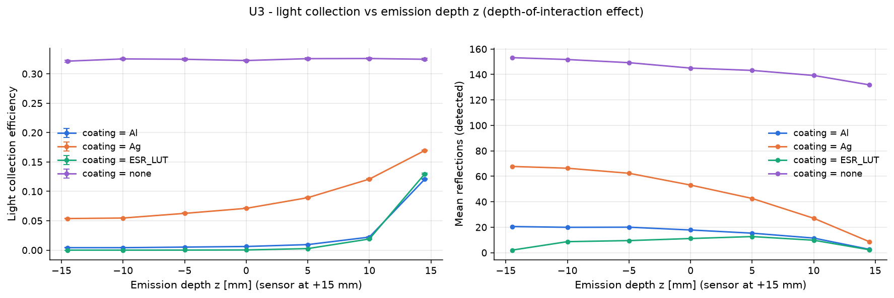

# U3 - light collection vs emission depth z (depth-of-interaction effect)

Photons emitted at a fixed depth z (sensor at +z). The LCE(z) slope sets the depth-dependent light non-uniformity, which broadens the energy resolution of thick channels.

Base configuration: `unit_optical.yaml`; fixed overrides: `{'beam.optical.z_uniform': False}`

## Results

| optics.coating   |   beam.optical.z |     lce |   mean_refl_det |
|:-----------------|-----------------:|--------:|----------------:|
| Al               |            -14.5 | 0.00415 |          20.54  |
| Al               |            -10   | 0.00417 |          19.93  |
| Al               |             -5   | 0.00517 |          20.03  |
| Al               |              0   | 0.00621 |          17.83  |
| Al               |              5   | 0.00941 |          15.33  |
| Al               |             10   | 0.02217 |          11.48  |
| Al               |             14.5 | 0.1207  |           2.665 |
| Ag               |            -14.5 | 0.05375 |          67.76  |
| Ag               |            -10   | 0.05462 |          66.36  |
| Ag               |             -5   | 0.06255 |          62.39  |
| Ag               |              0   | 0.0711  |          53.12  |
| Ag               |              5   | 0.08927 |          42.6   |
| Ag               |             10   | 0.1208  |          27.04  |
| Ag               |             14.5 | 0.1695  |           8.679 |
| ESR_LUT          |            -14.5 | 1e-05   |           2     |
| ESR_LUT          |            -10   | 3e-05   |           8.667 |
| ESR_LUT          |             -5   | 8e-05   |           9.5   |
| ESR_LUT          |              0   | 0.00032 |          11.12  |
| ESR_LUT          |              5   | 0.00263 |          12.66  |
| ESR_LUT          |             10   | 0.01899 |           9.787 |
| ESR_LUT          |             14.5 | 0.1298  |           2.318 |
| none             |            -14.5 | 0.3215  |         153.2   |
| none             |            -10   | 0.3253  |         151.8   |
| none             |             -5   | 0.3247  |         149.3   |
| none             |              0   | 0.3226  |         145     |
| none             |              5   | 0.3258  |         143.2   |
| none             |             10   | 0.326   |         139.2   |
| none             |             14.5 | 0.3247  |         131.9   |

## Automatic observations

- **Light collection efficiency**: max 0.326 at beam.optical.z = 10.0, min 1e-05 at beam.optical.z = -14.5 (ratio 3.26e+04)
  - lce has no monotonic trend with beam.optical.z (Pearson r = 0.18)
- **Mean reflections (detected)**: max 153.2 at beam.optical.z = -14.5, min 2 at beam.optical.z = -14.5 (ratio 76.6)
  - mean_refl_det has no monotonic trend with beam.optical.z (Pearson r = -0.14)
