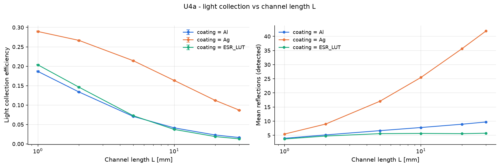

# U4a - light collection vs channel length L

Aspect ratio L/D at fixed D = 200 um. Longer channels absorb more X-rays but need more reflections: N ~ L / (D tan(theta)).

Base configuration: `unit_optical.yaml`; fixed overrides: `{}`

## Results

| optics.coating   |   geometry.length |     lce |   mean_refl_det |
|:-----------------|------------------:|--------:|----------------:|
| Al               |                 1 | 0.1867  |           3.943 |
| Al               |                 2 | 0.1337  |           5.135 |
| Al               |                 5 | 0.07076 |           6.645 |
| Al               |                10 | 0.04119 |           7.748 |
| Al               |                20 | 0.02288 |           8.92  |
| Al               |                30 | 0.01637 |           9.709 |
| Ag               |                 1 | 0.2894  |           5.452 |
| Ag               |                 2 | 0.2666  |           8.98  |
| Ag               |                 5 | 0.2143  |          17.05  |
| Ag               |                10 | 0.1634  |          25.47  |
| Ag               |                20 | 0.112   |          35.65  |
| Ag               |                30 | 0.0869  |          41.91  |
| ESR_LUT          |                 1 | 0.2035  |           3.694 |
| ESR_LUT          |                 2 | 0.1461  |           4.738 |
| ESR_LUT          |                 5 | 0.07264 |           5.582 |
| ESR_LUT          |                10 | 0.03723 |           5.662 |
| ESR_LUT          |                20 | 0.0188  |           5.574 |
| ESR_LUT          |                30 | 0.01297 |           5.738 |

## Automatic observations

- **Light collection efficiency**: max 0.2894 at geometry.length = 1.0, min 0.01297 at geometry.length = 30.0 (ratio 22.3)
  - lce decreases with geometry.length (Pearson r = -0.69)
- **Mean reflections (detected)**: max 41.91 at geometry.length = 30.0, min 3.694 at geometry.length = 1.0 (ratio 11.3)
  - mean_refl_det has no monotonic trend with geometry.length (Pearson r = 0.46)
