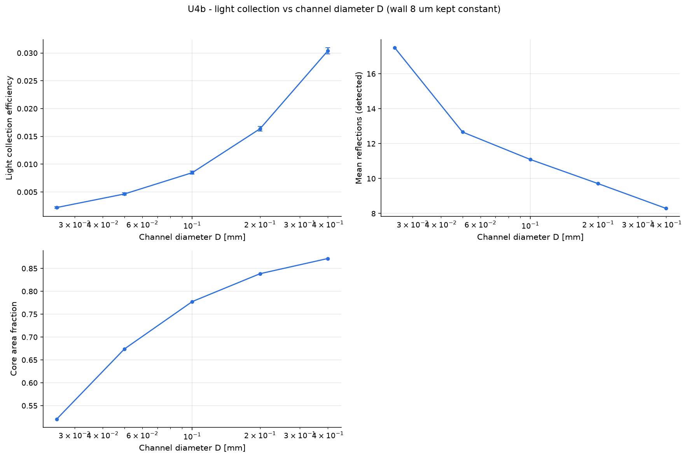

# U4b - light collection vs channel diameter D (wall 8 um kept constant)

D and pitch are scanned together (zip) so that the wall thickness stays at 8 um - 2 x 2 um coating.

Base configuration: `unit_optical.yaml`; fixed overrides: `{}`

## Results

|   geometry.channel_diameter |   geometry.pitch |     lce |   mean_refl_det |   geometry_fill_factor |
|----------------------------:|-----------------:|--------:|----------------:|-----------------------:|
|                       0.025 |            0.033 | 0.0022  |          17.49  |                 0.5205 |
|                       0.05  |            0.058 | 0.00464 |          12.66  |                 0.674  |
|                       0.1   |            0.108 | 0.00847 |          11.09  |                 0.7775 |
|                       0.2   |            0.208 | 0.01637 |           9.709 |                 0.8385 |
|                       0.4   |            0.408 | 0.0304  |           8.292 |                 0.8717 |

## Automatic observations

- **Light collection efficiency**: max 0.0304 at geometry.channel_diameter = 0.4, min 0.0022 at geometry.channel_diameter = 0.025 (ratio 13.8)
  - lce increases with geometry.channel_diameter (Pearson r = 1.00)
- **Mean reflections (detected)**: max 17.49 at geometry.channel_diameter = 0.025, min 8.292 at geometry.channel_diameter = 0.4 (ratio 2.11)
  - mean_refl_det decreases with geometry.channel_diameter (Pearson r = -0.81)
- **Core area fraction**: max 0.8717 at geometry.channel_diameter = 0.4, min 0.5205 at geometry.channel_diameter = 0.025 (ratio 1.67)
  - geometry_fill_factor increases with geometry.channel_diameter (Pearson r = 0.81)
