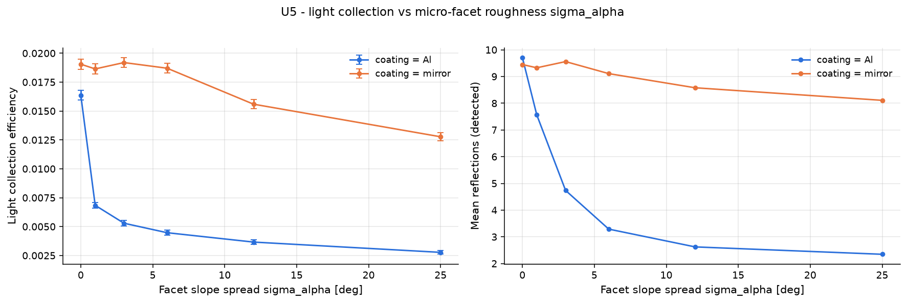

# U5 - light collection vs micro-facet roughness sigma_alpha

Ground metal surfaces (unified model, pure lobe reflection). Roughness randomises the reflection angle: photons leave TIR-like trajectories and need more bounces.

Base configuration: `unit_optical.yaml`; fixed overrides: `{}`

## Results

| optics.coating   |   optics.coating_sigma_alpha |     lce |   mean_refl_det |
|:-----------------|-----------------------------:|--------:|----------------:|
| Al               |                            0 | 0.01637 |           9.709 |
| Al               |                            1 | 0.00684 |           7.561 |
| Al               |                            3 | 0.00529 |           4.737 |
| Al               |                            6 | 0.00447 |           3.289 |
| Al               |                           12 | 0.00366 |           2.623 |
| Al               |                           25 | 0.00277 |           2.347 |
| mirror           |                            0 | 0.01905 |           9.448 |
| mirror           |                            1 | 0.01864 |           9.326 |
| mirror           |                            3 | 0.01919 |           9.558 |
| mirror           |                            6 | 0.0187  |           9.108 |
| mirror           |                           12 | 0.01559 |           8.579 |
| mirror           |                           25 | 0.01277 |           8.108 |

## Automatic observations

- **Light collection efficiency**: max 0.01919 at optics.coating_sigma_alpha = 3.0, min 0.00277 at optics.coating_sigma_alpha = 25.0 (ratio 6.93)
  - lce has no monotonic trend with optics.coating_sigma_alpha (Pearson r = -0.39)
- **Mean reflections (detected)**: max 9.709 at optics.coating_sigma_alpha = 0.0, min 2.347 at optics.coating_sigma_alpha = 25.0 (ratio 4.14)
  - mean_refl_det has no monotonic trend with optics.coating_sigma_alpha (Pearson r = -0.45)
