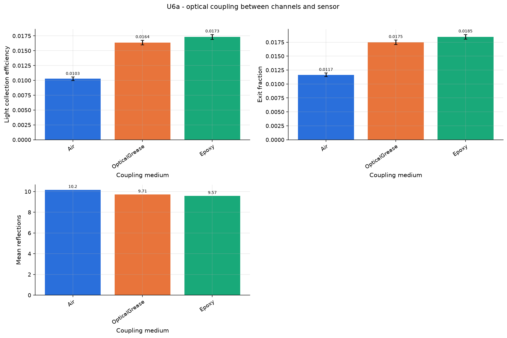

# U6a - optical coupling between channels and sensor

Air gap vs silicone grease vs epoxy (n = 1.0 / 1.465 / 1.55). With an air gap most photons are trapped by total internal reflection at the exit face of CsI (n = 1.79).

Base configuration: `unit_optical.yaml`; fixed overrides: `{}`

## Results

| geometry.coupling_material   |     lce |   lce_exit |   mean_refl_det |
|:-----------------------------|--------:|-----------:|----------------:|
| Air                          | 0.01027 |    0.01165 |          10.16  |
| OpticalGrease                | 0.01637 |    0.01748 |           9.709 |
| Epoxy                        | 0.01732 |    0.01846 |           9.568 |

## Automatic observations

- **Light collection efficiency**: max 0.01732 at geometry.coupling_material = Epoxy, min 0.01027 at geometry.coupling_material = Air (ratio 1.69)
- **Exit fraction**: max 0.01846 at geometry.coupling_material = Epoxy, min 0.01165 at geometry.coupling_material = Air (ratio 1.58)
- **Mean reflections**: max 10.16 at geometry.coupling_material = Air, min 9.568 at geometry.coupling_material = Epoxy (ratio 1.06)
