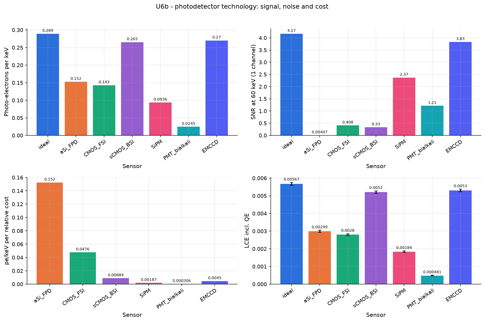

# U6b - photodetector technology: signal, noise and cost

60 keV X-rays in one CsI(Tl) channel read by different photodetectors. QE(lambda) x fill factor is applied on the sensor surface; read noise, pixel pitch and relative cost come from the catalogue (typical data-sheet values). Figures of merit: detected photo-electrons per keV, SNR for a 60 keV photon in one channel, and photo-electrons per keV per unit cost.

Base configuration: `unit_xray.yaml`; fixed overrides: `{}`

## Results

| geometry.sensor   |   det_yield_per_keV |   snr_60keV_per_channel |   det_yield_per_cost |       lce |
|:------------------|--------------------:|------------------------:|---------------------:|----------:|
| ideal             |             0.2892  |                4.165    |          inf         | 0.005671  |
| aSi_FPD           |             0.1524  |                0.004074 |            0.1524    | 0.002989  |
| CMOS_FSI          |             0.1429  |                0.4081   |            0.04762   | 0.002802  |
| sCMOS_BSI         |             0.2653  |                0.3305   |            0.008843  | 0.005202  |
| SiPM              |             0.09358 |                2.37     |            0.001872  | 0.001836  |
| PMT_bialkali      |             0.02449 |                1.212    |            0.0003061 | 0.0004806 |
| EMCCD             |             0.27    |                3.83     |            0.004501  | 0.005296  |

## Automatic observations

- **Photo-electrons per keV**: max 0.2892 at geometry.sensor = ideal, min 0.02449 at geometry.sensor = PMT_bialkali (ratio 11.8)
- **SNR at 60 keV (1 channel)**: max 4.165 at geometry.sensor = ideal, min 0.004074 at geometry.sensor = aSi_FPD (ratio 1.02e+03)
- **pe/keV per relative cost**: max inf at geometry.sensor = ideal, min 0.0003061 at geometry.sensor = PMT_bialkali (ratio inf)
- **LCE incl. QE**: max 0.005671 at geometry.sensor = ideal, min 0.0004806 at geometry.sensor = PMT_bialkali (ratio 11.8)
