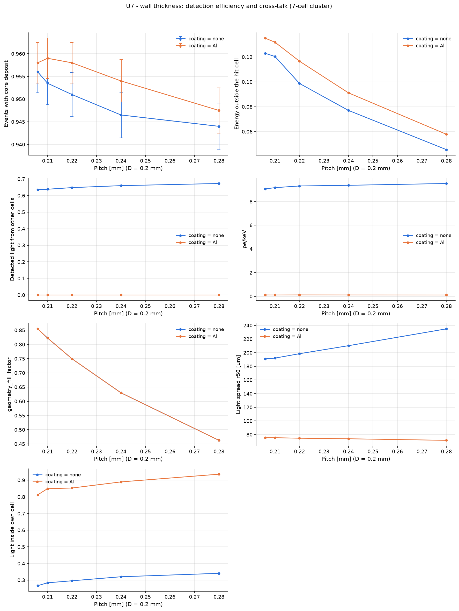

# U7 - wall thickness: detection efficiency and cross-talk (7-cell cluster)

D = 200 um fixed, the pitch is increased (thicker glass walls). Uniform 60 keV beam over the central cell. Thicker walls lower the scintillator fill factor but stop secondary electrons and fluorescence X-rays from leaking into the neighbours. Bare channels (none) are compared with Al-coated ones for optical cross-talk.

Base configuration: `cluster7_xray.yaml`; fixed overrides: `{}`

## Results

| optics.coating   |   geometry.pitch |   detection_efficiency |   em_crosstalk |   optical_crosstalk |   det_yield_per_keV |   geometry_fill_factor |   psf_r50_um |   psf_in_cell_fraction |
|:-----------------|-----------------:|-----------------------:|---------------:|--------------------:|--------------------:|-----------------------:|-------------:|-----------------------:|
| none             |            0.206 |                 0.956  |        0.123   |              0.6358 |              9.065  |                 0.8548 |       190.9  |                 0.2666 |
| none             |            0.21  |                 0.9535 |        0.1204  |              0.6379 |              9.168  |                 0.8226 |       192.1  |                 0.2838 |
| none             |            0.22  |                 0.951  |        0.09871 |              0.6477 |              9.31   |                 0.7495 |       198.5  |                 0.2959 |
| none             |            0.24  |                 0.9465 |        0.07703 |              0.6596 |              9.367  |                 0.6298 |       210.2  |                 0.3202 |
| none             |            0.28  |                 0.944  |        0.04547 |              0.6725 |              9.518  |                 0.4627 |       234.9  |                 0.3407 |
| Al               |            0.206 |                 0.958  |        0.1351  |              0      |              0.1166 |                 0.8548 |        75.5  |                 0.8125 |
| Al               |            0.21  |                 0.959  |        0.1319  |              0      |              0.1147 |                 0.8226 |        75.38 |                 0.8493 |
| Al               |            0.22  |                 0.958  |        0.1166  |              0      |              0.1191 |                 0.7495 |        74.67 |                 0.8532 |
| Al               |            0.24  |                 0.954  |        0.09115 |              0      |              0.116  |                 0.6298 |        73.84 |                 0.89   |
| Al               |            0.28  |                 0.9475 |        0.05781 |              0      |              0.1137 |                 0.4627 |        71.55 |                 0.9363 |

## Automatic observations

- **Events with core deposit**: max 0.959 at geometry.pitch = 0.21, min 0.944 at geometry.pitch = 0.28 (ratio 1.02)
  - detection_efficiency decreases with geometry.pitch (Pearson r = -0.83)
- **Energy outside the hit cell**: max 0.1351 at geometry.pitch = 0.20600000000000002, min 0.04547 at geometry.pitch = 0.28 (ratio 2.97)
  - em_crosstalk decreases with geometry.pitch (Pearson r = -0.96)
- **optical_crosstalk**: max 0.6725 at geometry.pitch = 0.28, min 0 at geometry.pitch = 0.20600000000000002
  - optical_crosstalk has no monotonic trend with geometry.pitch (Pearson r = 0.02)
- **pe/keV**: max 9.518 at geometry.pitch = 0.28, min 0.1137 at geometry.pitch = 0.28 (ratio 83.7)
  - det_yield_per_keV has no monotonic trend with geometry.pitch (Pearson r = 0.02)
- **geometry_fill_factor**: max 0.8548 at geometry.pitch = 0.20600000000000002, min 0.4627 at geometry.pitch = 0.28 (ratio 1.85)
  - geometry_fill_factor decreases with geometry.pitch (Pearson r = -0.99)
- **Light spread r50 [um]**: max 234.9 at geometry.pitch = 0.28, min 71.55 at geometry.pitch = 0.28 (ratio 3.28)
  - psf_r50_um has no monotonic trend with geometry.pitch (Pearson r = 0.11)
- **Light inside own cell**: max 0.9363 at geometry.pitch = 0.28, min 0.2666 at geometry.pitch = 0.20600000000000002 (ratio 3.51)
  - psf_in_cell_fraction has no monotonic trend with geometry.pitch (Pearson r = 0.11)
