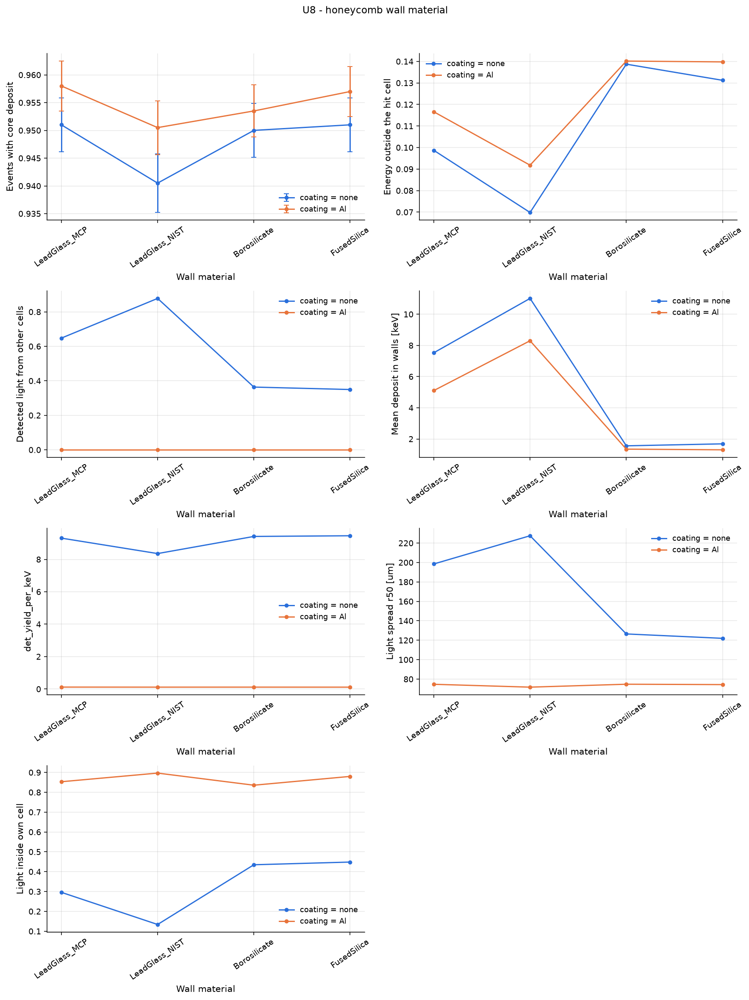

# U8 - honeycomb wall material

Lead glass stops cross-talk X-rays but absorbs part of the beam; low-Z glass does the opposite. 60 keV uniform beam on the central cell of a 7-cell cluster, bare and Al-coated channels.

Base configuration: `cluster7_xray.yaml`; fixed overrides: `{'geometry.pitch': '220 um'}`

## Results

| optics.coating   | geometry.wall_material   |   detection_efficiency |   em_crosstalk |   optical_crosstalk |   mean_edep_wall_keV |   det_yield_per_keV |   psf_r50_um |   psf_in_cell_fraction |
|:-----------------|:-------------------------|-----------------------:|---------------:|--------------------:|---------------------:|--------------------:|-------------:|-----------------------:|
| none             | LeadGlass_MCP            |                 0.951  |        0.09871 |              0.6477 |                7.529 |              9.31   |       198.5  |                 0.2959 |
| none             | LeadGlass_NIST           |                 0.9405 |        0.06984 |              0.8779 |               11.01  |              8.357  |       227.5  |                 0.1339 |
| none             | Borosilicate             |                 0.95   |        0.1387  |              0.3638 |                1.56  |              9.414  |       126.5  |                 0.4349 |
| none             | FusedSilica              |                 0.951  |        0.1312  |              0.3496 |                1.687 |              9.456  |       122    |                 0.4485 |
| Al               | LeadGlass_MCP            |                 0.958  |        0.1166  |              0      |                5.104 |              0.1191 |        74.67 |                 0.8532 |
| Al               | LeadGlass_NIST           |                 0.9505 |        0.09181 |              0      |                8.298 |              0.1161 |        71.72 |                 0.8967 |
| Al               | Borosilicate             |                 0.9535 |        0.1402  |              0      |                1.347 |              0.1169 |        74.74 |                 0.8357 |
| Al               | FusedSilica              |                 0.957  |        0.1398  |              0      |                1.304 |              0.1153 |        74.35 |                 0.88   |

## Automatic observations

- **Events with core deposit**: max 0.958 at geometry.wall_material = LeadGlass_MCP, min 0.9405 at geometry.wall_material = LeadGlass_NIST (ratio 1.02)
- **Energy outside the hit cell**: max 0.1402 at geometry.wall_material = Borosilicate, min 0.06984 at geometry.wall_material = LeadGlass_NIST (ratio 2.01)
- **optical_crosstalk**: max 0.8779 at geometry.wall_material = LeadGlass_NIST, min 0 at geometry.wall_material = LeadGlass_MCP
- **Mean deposit in walls [keV]**: max 11.01 at geometry.wall_material = LeadGlass_NIST, min 1.304 at geometry.wall_material = FusedSilica (ratio 8.45)
- **det_yield_per_keV**: max 9.456 at geometry.wall_material = FusedSilica, min 0.1153 at geometry.wall_material = FusedSilica (ratio 82)
- **Light spread r50 [um]**: max 227.5 at geometry.wall_material = LeadGlass_NIST, min 71.72 at geometry.wall_material = LeadGlass_NIST (ratio 3.17)
- **Light inside own cell**: max 0.8967 at geometry.wall_material = LeadGlass_NIST, min 0.1339 at geometry.wall_material = LeadGlass_NIST (ratio 6.69)
