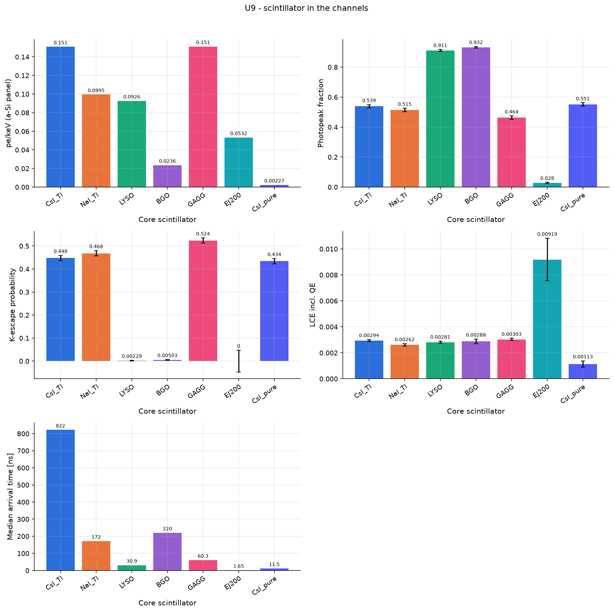

# U9 - scintillator in the channels

Same geometry, different scintillators (yield, density, refractive index, emission band). 60 keV pencil beam into one channel read by an a-Si flat panel.

Base configuration: `unit_xray.yaml`; fixed overrides: `{'materials.yield_scale': 0.1}`

## Results

| geometry.core_material   |   det_yield_per_keV |   photopeak_fraction |   k_escape_fraction |      lce |   t_det_median_ns |
|:-------------------------|--------------------:|---------------------:|--------------------:|---------:|------------------:|
| CsI_Tl                   |            0.1508   |               0.539  |            0.4477   | 0.002943 |            821.6  |
| NaI_Tl                   |            0.09948  |               0.515  |            0.4682   | 0.002618 |            171.5  |
| LYSO                     |            0.0926   |               0.9115 |            0.002292 | 0.002812 |             30.86 |
| BGO                      |            0.0236   |               0.932  |            0.005034 | 0.002881 |            219.6  |
| GAGG                     |            0.1511   |               0.4635 |            0.5237   | 0.003027 |             60.26 |
| EJ200                    |            0.05316  |               0.028  |            0        | 0.009185 |              1.65 |
| CsI_pure                 |            0.002274 |               0.551  |            0.4339   | 0.001132 |             11.52 |

## Automatic observations

- **pe/keV (a-Si panel)**: max 0.1511 at geometry.core_material = GAGG, min 0.002274 at geometry.core_material = CsI_pure (ratio 66.5)
- **Photopeak fraction**: max 0.932 at geometry.core_material = BGO, min 0.028 at geometry.core_material = EJ200 (ratio 33.3)
- **k_escape_fraction**: max 0.5237 at geometry.core_material = GAGG, min 0 at geometry.core_material = EJ200
- **LCE incl. QE**: max 0.009185 at geometry.core_material = EJ200, min 0.001132 at geometry.core_material = CsI_pure (ratio 8.12)
- **Median arrival time [ns]**: max 821.6 at geometry.core_material = CsI_Tl, min 1.65 at geometry.core_material = EJ200 (ratio 498)
