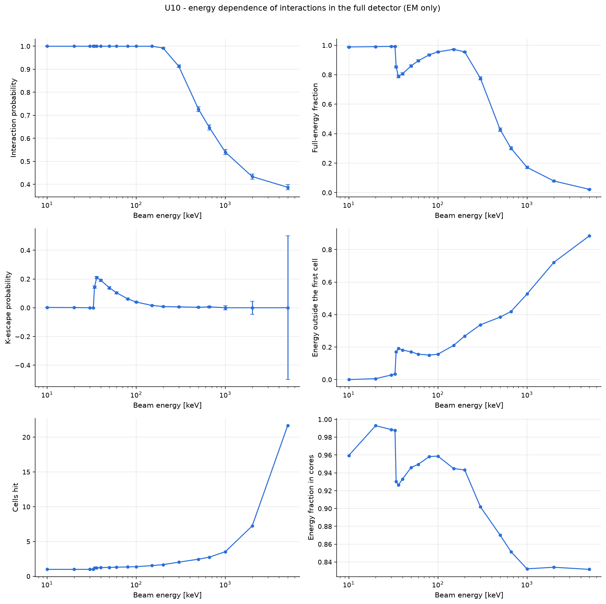
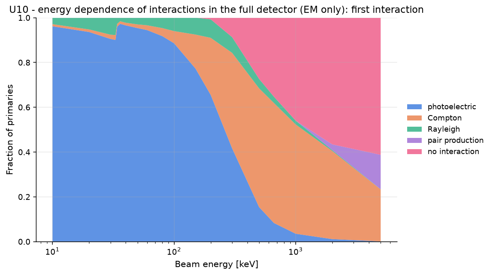
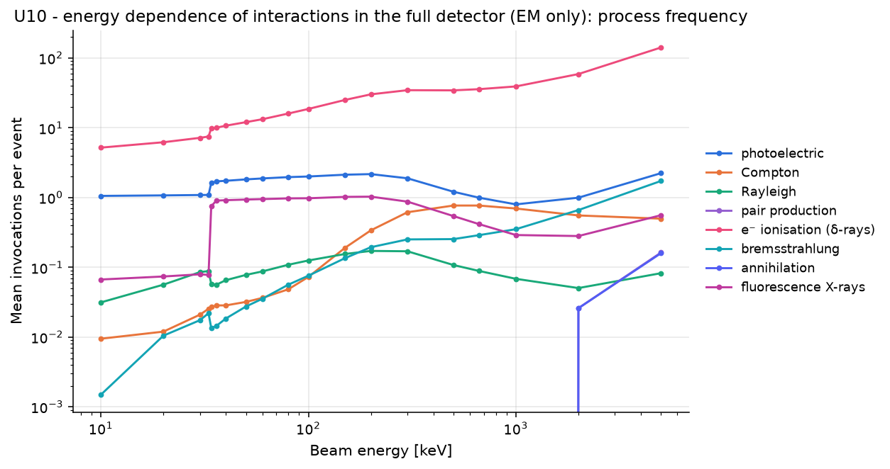

# U10 - energy dependence of interactions in the full detector (EM only)

Full detector, optical physics off (fast). Pencil beam on the central channel. Shows the first-interaction process mix (photoelectric / Compton / Rayleigh / pair) versus the beam energy, the K edges of I (33.2 keV) and Cs (36.0 keV), the photopeak and K-escape fractions and the lateral energy spread (cells hit).

Base configuration: `full.yaml`; fixed overrides: `{'beam.type': 'pencil', 'physics.optical': {'scintillation': False, 'cerenkov': False}, 'run.cell_hits': False}`

## Results

|   beam.energy |   interacting_fraction |   photopeak_fraction |   k_escape_fraction |   em_crosstalk |   mean_cells_hit |   core_energy_fraction |
|--------------:|-----------------------:|---------------------:|--------------------:|---------------:|-----------------:|-----------------------:|
|            10 |                 1      |               0.9885 |            0.00208  |       0        |           0.9995 |                 0.9595 |
|            20 |                 1      |               0.9905 |            0.001068 |       0.005615 |           1      |                 0.9929 |
|            30 |                 1      |               0.992  |            0        |       0.02819  |           1.003  |                 0.9886 |
|            33 |                 1      |               0.992  |            0        |       0.03448  |           1.004  |                 0.9877 |
|            34 |                 1      |               0.853  |            0.1438   |       0.1713   |           1.201  |                 0.9305 |
|            36 |                 1      |               0.788  |            0.2098   |       0.1921   |           1.226  |                 0.9264 |
|            40 |                 1      |               0.806  |            0.1911   |       0.1821   |           1.248  |                 0.933  |
|            50 |                 1      |               0.8595 |            0.1384   |       0.1704   |           1.287  |                 0.946  |
|            60 |                 1      |               0.894  |            0.1048   |       0.1568   |           1.311  |                 0.9495 |
|            80 |                 1      |               0.935  |            0.06213  |       0.1508   |           1.353  |                 0.9582 |
|           100 |                 1      |               0.955  |            0.03953  |       0.1561   |           1.388  |                 0.9588 |
|           150 |                 1      |               0.972  |            0.01618  |       0.2104   |           1.539  |                 0.9449 |
|           200 |                 0.9925 |               0.955  |            0.008397 |       0.2683   |           1.681  |                 0.9433 |
|           300 |                 0.913  |               0.7755 |            0.006002 |       0.3372   |           2.036  |                 0.9019 |
|           500 |                 0.7265 |               0.427  |            0.003247 |       0.3847   |           2.462  |                 0.87   |
|           662 |                 0.647  |               0.3005 |            0.006024 |       0.4194   |           2.754  |                 0.8514 |
|          1000 |                 0.54   |               0.1715 |            0        |       0.527    |           3.542  |                 0.8323 |
|          2000 |                 0.434  |               0.079  |            0        |       0.7218   |           7.24   |                 0.8341 |
|          5000 |                 0.3875 |               0.0225 |            0        |       0.8844   |          21.65   |                 0.8317 |

## Automatic observations

- **Interaction probability**: max 1 at beam.energy = 10.0, min 0.3875 at beam.energy = 5000.0 (ratio 2.58)
  - interacting_fraction decreases with beam.energy (Pearson r = -0.83)
- **Full-energy fraction**: max 0.992 at beam.energy = 30.0, min 0.0225 at beam.energy = 5000.0 (ratio 44.1)
  - photopeak_fraction decreases with beam.energy (Pearson r = -0.78)
- **k_escape_fraction**: max 0.2098 at beam.energy = 36.0, min 0 at beam.energy = 30.0
  - k_escape_fraction has no monotonic trend with beam.energy (Pearson r = -0.30)
- **em_crosstalk**: max 0.8844 at beam.energy = 5000.0, min 0 at beam.energy = 10.0
  - em_crosstalk increases with beam.energy (Pearson r = 0.87)
- **Cells hit**: max 21.65 at beam.energy = 5000.0, min 0.9995 at beam.energy = 10.0 (ratio 21.7)
  - mean_cells_hit increases with beam.energy (Pearson r = 0.99)
- **Energy fraction in cores**: max 0.9929 at beam.energy = 20.0, min 0.8317 at beam.energy = 5000.0 (ratio 1.19)
  - core_energy_fraction decreases with beam.energy (Pearson r = -0.68)
